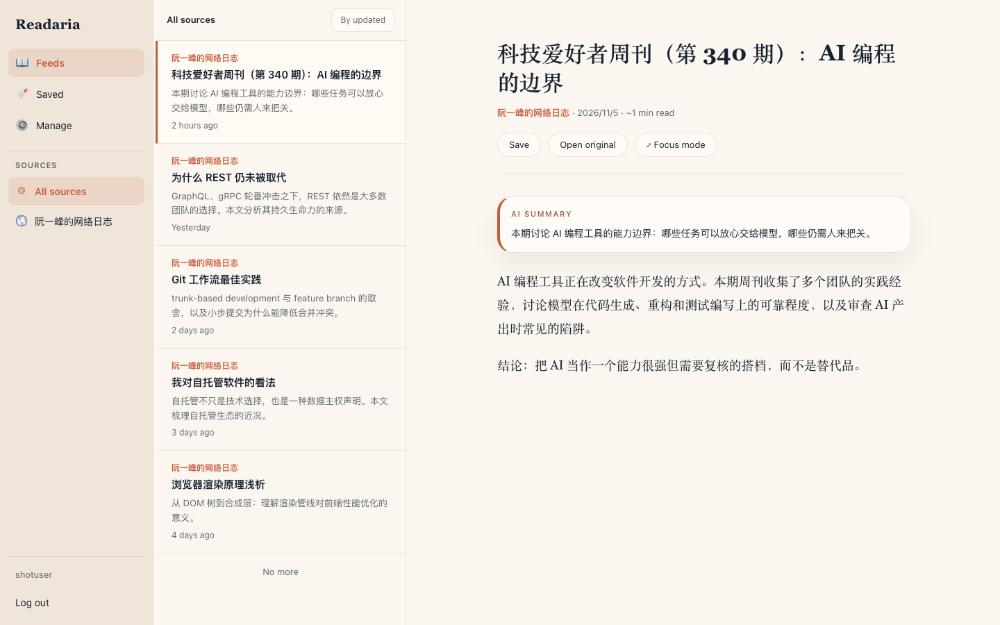
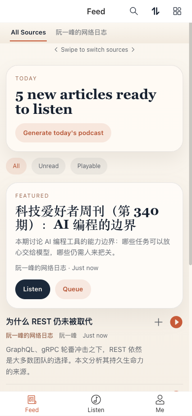
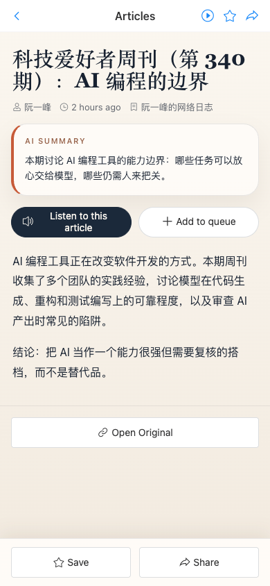
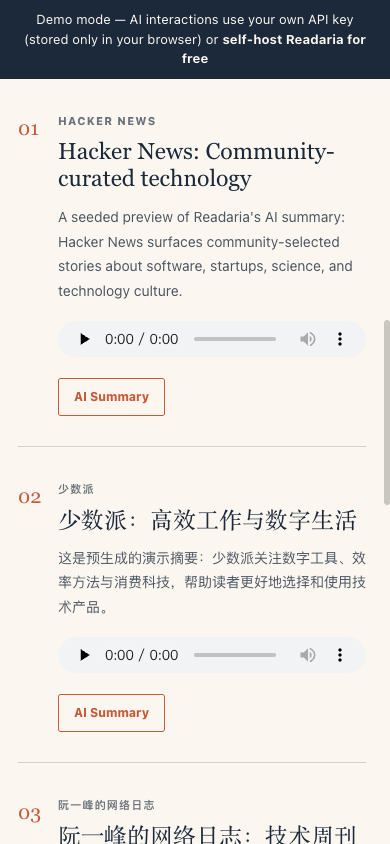

# Readaria

Self-hosted, mobile-first RSS reading with text-to-speech and AI-generated podcasts, delivered as an installable PWA.

**[Live demo](https://demo.readaria.com)** · Self-host with Docker below · [简体中文说明](README.zh-CN.md)

<p align="center">
  
</p>
<p align="center">
  
  
  
</p>

## Features

- **RSS reading**: subscribe to RSS/Atom feeds, import and export OPML, refresh feeds on a schedule or on demand, and keep saved articles and reading history.
- **Article narration**: server-generated audio with Google Cloud TTS, Azure OpenAI TTS, Azure Speech, or OpenAI TTS; browser Web Speech playback is available as a fallback.
- **AI podcasts**: turn recent feed articles into a scripted audio podcast. Generate one manually from the Listen view, or enable the scheduled daily generation job.
- **AI assistance**: article summaries and podcast Q&A through an OpenAI-compatible API, with optional OpenRouter fallback.
- **Mobile and desktop**: an installable Vue PWA with a mobile-first interface, desktop reading layout, playback queue, and Media Session integration.
- **Optional feed routes**: subscribe to RSSHub URLs for supported platforms, including compatible WeChat routes.

## Quick Start (Docker)

Prerequisites: Docker with Docker Compose v2.

```bash
git clone https://github.com/Blacksheeppy123/readaria.git
cd readaria
cp .env.example .env
# Edit .env: set a unique database password and strong SECRET_KEY/JWT_SECRET_KEY values.
docker compose up -d
```

Open `http://localhost:8000` to use the Readaria PWA; the API image includes the built frontend, so no separate frontend deployment is required. The API documentation is available at `http://localhost:8000/docs` by default. See [docs/self-hosting.md](docs/self-hosting.md) for configuration, upgrades, backups, and troubleshooting.

**Running without AI provider accounts:** RSS reading does not call an AI provider, and supported browsers can narrate articles through the Web Speech fallback. Server-side TTS, AI summaries, podcast generation, and podcast Q&A require valid provider credentials. Leave the example `OPENAI_API_KEY` placeholder in place if you only use non-AI features; replace it before enabling AI features.

## Architecture

Readaria combines a **FastAPI** backend, **PostgreSQL** for application data, **Redis** for caching, and **APScheduler** for hourly feed refreshes and optional daily podcast generation. The frontend is a **Vue 3 + Vant** PWA built with Vite, using Pinia for state and HTML5 Audio/Web Speech for playback.

## Configuration

All backend settings and safe placeholder values are documented in [`.env.example`](.env.example). Never commit your real `.env` or credentials.

The main provider options are:

| Feature | Configuration |
| --- | --- |
| AI summaries and podcast scripts | `OPENAI_API_KEY`, `OPENAI_BASE_URL`, `OPENAI_MODEL`; optional `OPENROUTER_*` fallback |
| Server-side article/podcast audio | `TTS_PROVIDER=google`, `azure`, `azure_speech`, or `openai`, plus the matching provider credentials |
| Scheduled podcasts | `PODCAST_ENABLED`, `PODCAST_GENERATION_HOUR`, `PODCAST_GENERATION_MINUTE` (UTC) |
| Feed routing | `RSSHUB_ALLOWED_HOSTS` and optional WeChat settings |

Podcast generation uses the configured OpenAI-compatible chat API **and** the selected server-side TTS provider. Some podcast and Q&A model names are currently fixed in the service code, so check that your endpoint supports them before relying on a non-OpenAI provider.

## RSSHub and WeChat

Readaria accepts RSSHub feed URLs and uses public RSSHub instances for its built-in route handling. Public instances and individual routes may have their own availability, authentication requirements, and usage limits.

WeChat public-account links with the required account information can be converted to compatible RSSHub routes. **wechat2rss** is a separate, paid third-party service; it is optional, is not bundled with Readaria, and is not affiliated with this project.

## Contributing

Issues and pull requests are welcome. Please read [CONTRIBUTING.md](CONTRIBUTING.md) and run `make test-quick` before submitting a change. Security reports should follow [SECURITY.md](SECURITY.md).

## License

Readaria is licensed under the [GNU Affero General Public License v3.0](LICENSE).

The Readaria name and logo are trademarks of the maintainer and may not be used to identify hosted derivative services without permission.

## Disclaimer

Readaria is self-hosted software. You are responsible for your deployment, provider costs, and compliance with the terms of service, robots policies, and copyright rules of the content platforms and third-party services you access. AI-generated summaries, scripts, and audio may contain inaccuracies; consult the original sources.
