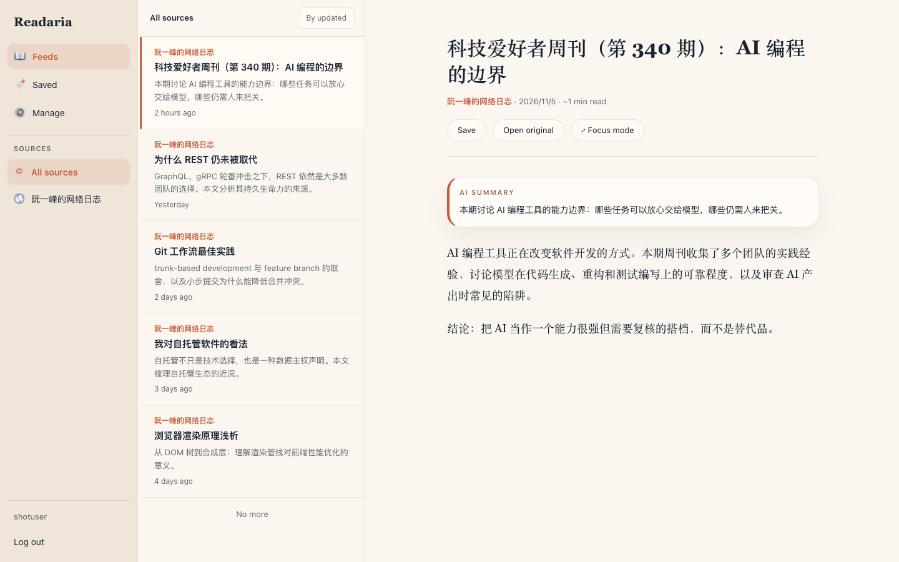
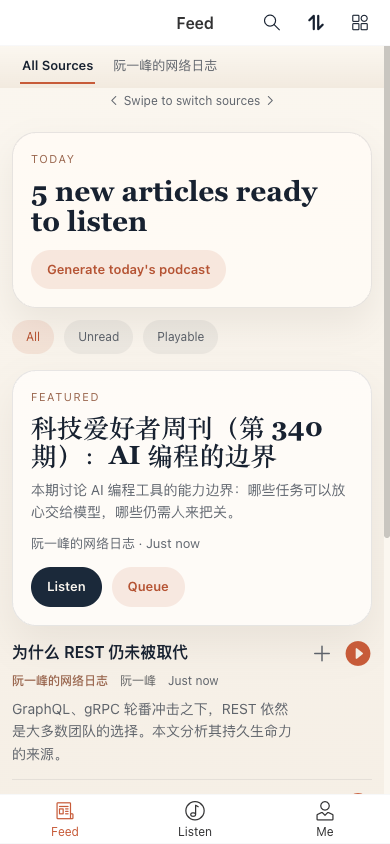
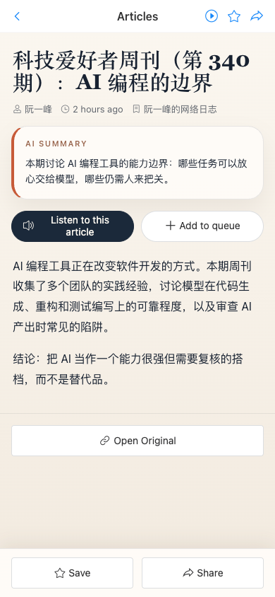
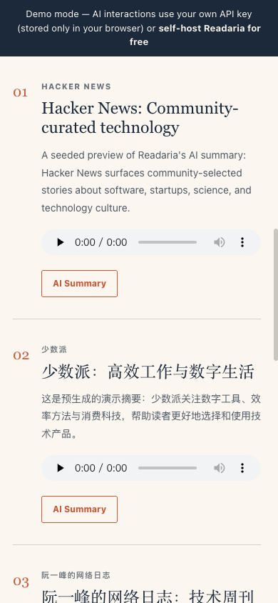

# Readaria

自托管、移动优先的 RSS 阅读器：AI 摘要 + 语音朗读 + 把未读文章变成每日 AI 播客。可安装的 PWA。

**[English README](README.md)** · **[在线 Demo](https://demo.readaria.com)** · 用 Docker 自托管（见下文）

<p align="center">
  
</p>
<p align="center">
  
  
  
</p>

## 功能

- **RSS 阅读**：订阅 RSS/Atom 源，OPML 导入导出，定时或手动刷新，收藏与阅读历史。
- **文章朗读**：服务端 TTS（Google Cloud / Azure OpenAI / Azure Speech / OpenAI），浏览器 Web Speech 兜底（无需任何 key）。
- **AI 播客**：把最近的未读文章变成带脚本的音频播客。可在 Listen 页手动生成，或开启每日定时任务；可导出为标准播客 RSS，用任意播客客户端订阅。
- **AI 助手**：基于 OpenAI 兼容 API 的文章摘要与播客问答，可选 OpenRouter 兜底（支持本地模型）。
- **移动端与桌面**：移动优先的 Vue PWA（可安装到手机/桌面），桌面三栏阅读布局，播放队列与 Media Session 集成。
- **可选源路由**：支持 RSSHub URL（含微信公众号等兼容路由）。

## 快速开始（Docker）

前置：Docker 与 Docker Compose v2。

```bash
git clone https://github.com/Blacksheeppy123/readaria.git
cd readaria
cp .env.example .env
# 编辑 .env：设置数据库密码和足够长的 SECRET_KEY / JWT_SECRET_KEY
docker compose up -d
```

打开 `http://localhost:8000` 即可使用（前端已内置在 API 镜像中，无需单独部署前端）。API 文档默认在 `http://localhost:8000/docs`。配置、升级、备份与排障见 [docs/self-hosting.md](docs/self-hosting.md)。

**不用 AI 也能玩**：RSS 阅读不调用 AI；支持的浏览器可用 Web Speech 朗读文章。服务端 TTS、AI 摘要、播客生成需要配置相应服务的凭据。

## 架构

FastAPI 后端 + PostgreSQL + Redis + APScheduler（每小时抓取 / 可选每日播客）；前端为 Vue 3 + Vant PWA（Vite 构建、Pinia 状态管理、HTML5 Audio/Web Speech 播放）。

## 配置

所有配置与安全占位值见 [`.env.example`](.env.example)。切勿提交真实 `.env` 或凭据。

| 功能 | 配置项 |
| --- | --- |
| AI 摘要与播客脚本 | `OPENAI_API_KEY`、`OPENAI_BASE_URL`、`OPENAI_MODEL`；可选 `OPENROUTER_*` 兜底 |
| 服务端文章/播客音频 | `TTS_PROVIDER=google` / `azure` / `azure_speech` / `openai` 及对应凭据 |
| 定时播客 | `PODCAST_ENABLED`、`PODCAST_GENERATION_HOUR`、`PODCAST_GENERATION_MINUTE`（UTC） |
| 源路由 | `RSSHUB_ALLOWED_HOSTS` 与可选微信相关配置 |

## RSSHub 与微信

支持 RSSHub 源 URL；内置路由处理走公共 RSSHub 实例（可用性与限流以实例为准）。**wechat2rss** 是独立的第三方付费服务：可选、不捆绑、与本项目无附属关系。

## 贡献

欢迎 issue 与 PR。请阅读 [CONTRIBUTING.md](CONTRIBUTING.md)，提交前运行 `make test-quick`。安全问题请按 [SECURITY.md](SECURITY.md) 私密报告。

## 许可证

[AGPL-3.0](LICENSE)。Readaria 名称与标识为维护者商标，未经许可不得用于衍生托管服务。

## 免责声明

自托管软件，使用者自行负责部署安全、服务商费用以及所访问平台的 ToS 合规。AI 生成的摘要、脚本与音频可能有误，请以原文为准。
